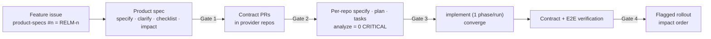

# Relm — an AI-native software company

We build **Relm Commerce** with small human teams and many coding agents, using
**spec-driven development** with [GitHub Spec Kit](https://github.com/github/spec-kit).
Humans own intent, decisions and acceptance; agents draft specs, plans, code and tests;
automated gates and named reviewers decide what merges.

## Start here

1. 📘 **[sdd-handbook](https://github.com/spec-kit-relm/sdd-handbook)** — how we work: the AI SDLC,
   work lanes, company/team/repository rules, playbooks.
2. 🧭 **[product-specs](https://github.com/spec-kit-relm/product-specs)** — every feature starts here
   as a Feature issue (`RELM-<n>`) and a product spec. Worked example: **RELM-1 Stock reservation at checkout**.
3. 🛠️ **[speckit-platform](https://github.com/spec-kit-relm/speckit-platform)** — the machinery: canonical
   constitution, Spec Kit presets/extension, CI gates, bootstrap scripts.

## Repositories

| Repository | Team | What it is | Spec Kit kind |
|------------|------|------------|---------------|
| [sdd-handbook](https://github.com/spec-kit-relm/sdd-handbook) | SDD Guild | Process, rules, playbooks (for humans) | — |
| [speckit-platform](https://github.com/spec-kit-relm/speckit-platform) | SDD Guild | Governance source, presets, extension, reusable workflows (for machines) | — |
| [product-specs](https://github.com/spec-kit-relm/product-specs) | Product & Architecture | Product specs, impact maps, contract registry | `product` |
| [inventory-service](https://github.com/spec-kit-relm/inventory-service) | Backend | Stock, reservations, inventory events (Go) | `backend` |
| [orders-service](https://github.com/spec-kit-relm/orders-service) | Backend | Order placement (Java / Spring Boot) | `backend` |
| [web-storefront](https://github.com/spec-kit-relm/web-storefront) | Frontend | Customer web app (Next.js / TypeScript) | `frontend` |
| [e2e-tests](https://github.com/spec-kit-relm/e2e-tests) | Quality Engineering | Cross-service E2E suites, scenario coverage (Playwright) | `qa` |
| [.github](https://github.com/spec-kit-relm/.github) | SDD Guild | This profile, default issue/PR templates, workflow templates | — |

## How a feature flows

## Rules in three layers

| Layer | Rules | Lives in |
|-------|-------|----------|
| Company | ORG-1 … ORG-9 | Part A of every constitution, synced from `speckit-platform/governance` |
| Team | BE-*, FE-*, QA-*, PRD-* | Part B, synced per team |
| Repository | ORD-*, INV-*, WEB-*, E2E-*, PS-* + `AGENTS.md` | Part C, owned by each repository |

*This organization is a reference implementation of enterprise-scale Spec Kit adoption: the
company, its people and its product are fictional; the process and tooling are real and runnable.*
